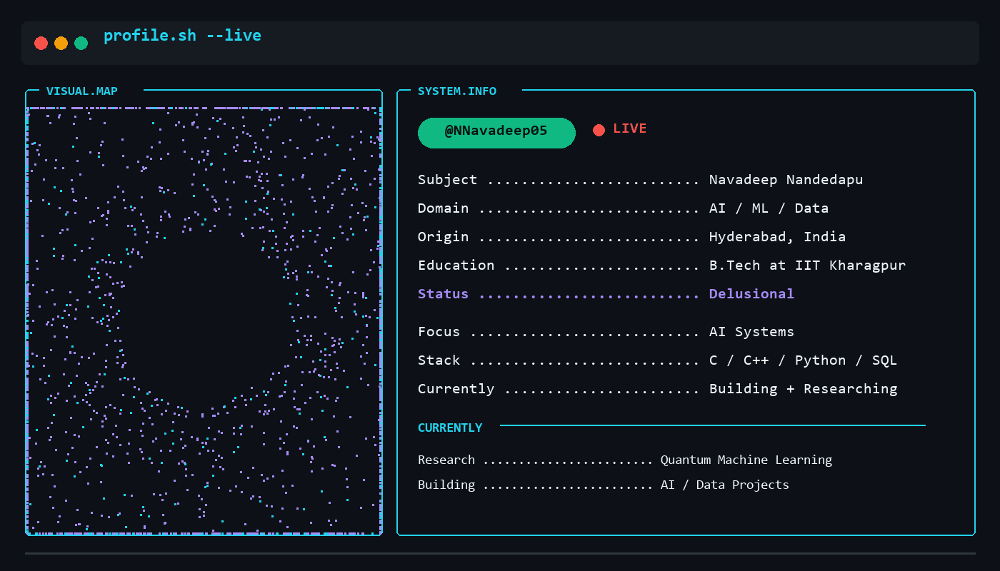
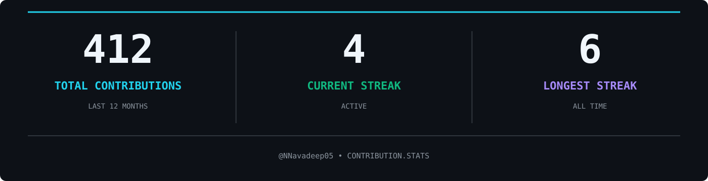

  

  
  
  

 

<h2 align="center">PROJECTS</h2>

<table>
  <tr>
    <td width="50%" valign="top">
      <b><a href="https://github.com/NNavadeep05/adaptive-self-healing-rag">Adaptive Self-Healing RAG</a></b> 
      RAG pipeline for financial documents with self-verification, adaptive retrieval and reranking, evaluated on SEC 10-K filings. 
      Python · LangGraph · Docker
    </td>
    <td width="50%" valign="top">
      <b><a href="https://github.com/NNavadeep05/SQL-OpenEnv">SQL-OpenEnv</a></b> 
      OpenEnv environment for training agents to write and optimize SQL queries, with shaped rewards across three tasks. 
      Python · Reinforcement Learning · SQL
    </td>
  </tr>
  <tr>
    <td width="50%" valign="top">
      <b><a href="https://github.com/NNavadeep05/sasrec-recommender">SASRec Recommender</a></b> 
      Sequential recommender on MovieLens-1M using causal Transformer attention. 
      Python · PyTorch
    </td>
    <td width="50%" valign="top">
      <b><a href="https://github.com/NNavadeep05/HENS-Astar">HENS-A*</a></b> 
      A*-based heat exchanger network synthesis with thermodynamic feasibility checks and pinch-based heuristics. 
      Python · Search · Optimization
    </td>
  </tr>
  <tr>
    <td width="50%" valign="top">
      <b><a href="https://github.com/NNavadeep05/French-English-Transformer">French–English Transformer</a></b> 
      Seq2seq Transformer for neural machine translation, benchmarked against a GRU baseline. 
      Python · NLP
    </td>
    <td width="50%" valign="top">
      <b><a href="https://github.com/NNavadeep05/Rubiks-Cube-Solver-Cpp">Rubik's Cube Solver</a></b> 
      Object-oriented C++ solver using BFS, IDDFS and IDA* search. 
      C++ · Algorithms
    </td>
  </tr>
</table>

 

<h2 align="center">TECH STACK</h2>

  

 

<h2 align="center">CONTRIBUTIONS</h2>

  

  

